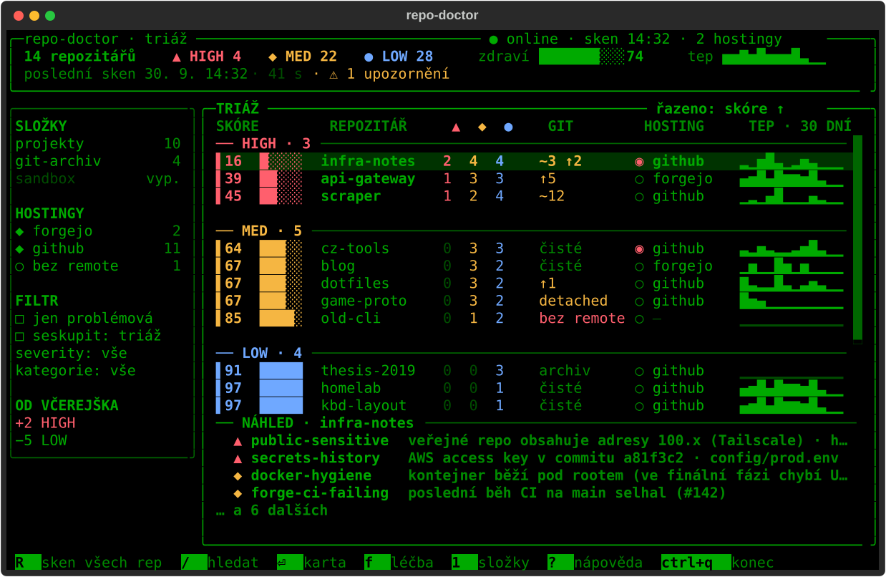

# repo-doctor

A TUI for auditing and maintaining git repositories. It walks one or more of your
repository folders, optionally connects to their git hosts (GitHub, Gitea, Forgejo, GitLab),
finds security and hygiene problems, produces a clear report and can **safely** prepare
fixes – always as commits on a new branch that you review yourself – and, on request,
push them, open a PR/MR and merge it.



📖 **[User guide (wiki)](https://github.com/Icenux/repo-doctor/wiki)**: all screens with screenshots, checks, configuration and FAQ.

- **Triage instead of a list:** repositories sorted into the bands CRITICAL / WATCH / NO PULSE / HEALTHY,
  a 0–100 score, pulse (commits in the last 30 days), git state and visibility on the host.
- **Repo card** with a diagnosis of every finding, an explanation and manual fix steps.
- **Treatment:** colored diff of the proposed fixes, selection with checkboxes and confirmation in a dialog.
- **Publishing fixes:** a dedicated page (`p` on the repo card) with push of the fix branch, PR/MR on GitHub,
  GitLab, Gitea and Forgejo, merge on the host (only after green CI) and local merge. It shows
  the PR and the CI state per individual check. Every step is separate, with a preview and confirmation – see [Publishing fixes](#publishing-fixes-push-pr-merge).
- **Heal and carry through (`P` in Treatment):** select several problems in a repo and let repo-doctor do the whole
  path in the background – fix branch, push, PR, waiting for CI and, **only after green CI**, merge. If CI fails
  (or does not start, or the host refuses) the workflow stops and you see it in the **Notifications** block on
  the overview; clicking a notification opens the Publishing fixes page of that repo. See [Heal and carry through](#heal-and-carry-through-one-go-to-merge).
- **Works fully offline** and without any host; network checks (OSV.dev, PyPI, npm, host APIs) are an add-on.
- **Minimal CLI** for CI (`repo-doctor scan --report md|json|html`).
- **What's new in 0.3:** a standalone application that needs no Python or other runtime – `.deb`, `.rpm`,
  AUR and tarball packages; updates arrive with system updates and the TUI notifies you about a new version.
- **What's new in 0.2:** the checks `ci-security` (GitHub Actions), `email-exposure`, `duplicate-clone`,
  `license-compat`, `disk-usage` and `prepush-guard`; SBOM (CycloneDX), disk **Cleanup** via the trash,
  **Sync** by fast-forward only, a scheduled scan with notifications and an MCP server for AI
  assistants (read-only).

## Installation

repo-doctor is a standalone application for Linux (x86_64). It bundles everything it needs, so
you don't have to deal with Python or any other environment. All you need is **git**. Even fixes
require nothing else: repo-doctor updates vulnerable dependencies in `uv.lock` and
`package-lock.json` by itself, without `uv` and `npm`.

### Debian, Ubuntu, Linux Mint, Pop!_OS…

```sh
wget https://github.com/Icenux/repo-doctor/releases/latest/download/repo-doctor_amd64.deb
sudo apt install ./repo-doctor_amd64.deb
```

### Fedora, RHEL, Rocky, Alma…

```sh
sudo dnf install https://github.com/Icenux/repo-doctor/releases/latest/download/repo-doctor.x86_64.rpm
```

### Arch Linux

The `repo-doctor-bin` package from the AUR (e.g. `yay -S repo-doctor-bin`). Without an AUR helper,
download the `PKGBUILD` from the [latest release](https://github.com/Icenux/repo-doctor/releases/latest)
and run `makepkg -si` in its folder.

### Other distributions

```sh
wget https://github.com/Icenux/repo-doctor/releases/latest/download/repo-doctor-linux-x86_64.tar.gz
tar xzf repo-doctor-linux-x86_64.tar.gz && ./repo-doctor/install.sh
```

The application is installed to `~/.local/lib/repo-doctor` and the `repo-doctor` command to
`~/.local/bin` (no root needed). If your shell can't find it, add `~/.local/bin` to `PATH`.

### Verification

```sh
repo-doctor --version
repo-doctor checks          # list of available checks
```

Then continue with the [Quick start](#quick-start).

### Optional tools

Everything works without them; the corresponding feature is simply turned off. You manage them on
the **Tools** screen (key `8`) or with the `repo-doctor tools` command: you see the state, where the
tool comes from (the system, or downloaded by repo-doctor, with its version) and what is missing. `i`
in the TUI (`repo-doctor tools --install`) installs the missing ones after confirmation:

- system packages through the distribution's package manager (`apt-get`, `dnf`, `pacman`, `zypper`).
  The TUI pauses for a moment and the command runs visibly in the terminal through `sudo`.
  repo-doctor never obtains root by itself.
- `gitleaks` where the distribution doesn't ship it (Debian 12, Ubuntu 22.04): the official
  binary is downloaded to `~/.local/share/repo-doctor/tools` and verified against the SHA-256
  recorded in repo-doctor.

`u` (`--update`) updates a downloaded binary to the version pinned in repo-doctor and `d`
(`--remove gitleaks`) deletes it. System packages are updated and uninstalled by the package manager.

| tool | purpose |
|---|---|
| `gitleaks` | faster and more accurate secret scan |
| `wl-clipboard` | copying a path to the clipboard (Wayland) |
| `xdg-utils` | opening the repo on the web |
| `libnotify` (`notify-send`) | desktop notification from the scheduled scan |
| Secret Service keyring (GNOME Keyring, KWallet) | storing host tokens. Not installed by repo-doctor; it must be running in your login session |

### Updates

- **.deb / .rpm:** on installation the package adds the signed
  [Icenux](https://github.com/Icenux/icenux) repository (shared by my applications), so new
  versions arrive **with the regular system update** (`sudo apt update && sudo apt upgrade`,
  `sudo dnf upgrade` or the graphical Software Updater).
- **AUR:** with an update through your AUR helper (`yay -Syu`).
- **Tarball:** `repo-doctor update` downloads the new release, verifies its signature and checksum
  (with a key built into the application) and only then replaces the old version. Requires `gpg`.

Once a day the TUI checks whether a new version has been released and notifies you. Turn it off with
`[updates] check = false`; in offline mode no check is made. Manually: `repo-doctor update --check`.

### Uninstallation

```sh
sudo apt remove repo-doctor          # Debian/Ubuntu (the Icenux repository stays, it belongs to all applications)
sudo dnf remove repo-doctor          # Fedora (the Icenux repository stays)
sudo pacman -R repo-doctor-bin       # Arch
rm -rf ~/.local/lib/repo-doctor ~/.local/bin/repo-doctor   # tarball
```

Before uninstalling, turn off any scheduled scan (`repo-doctor schedule remove`). Configuration,
cache and history stay in `~/.config/repo-doctor`, `~/.cache/repo-doctor`
and `~/.local/share/repo-doctor` (or according to `XDG_*`) – delete them manually if you don't want them.
Remove tokens stored in the keyring in its manager.

## Quick start

```sh
repo-doctor                 # TUI over the folders from the configuration
repo-doctor ~/projects      # other folders just this once (nothing is saved)
```

On the first run (without a configuration) a **wizard** opens: you enter the folders with repositories
(Tab completes the path, Enter adds it), the wizard suggests a search depth based on the repositories
it found and you can optionally add a git host. `Ctrl+S` saves the configuration and starts the first scan.
After that the TUI always opens immediately with the results of the last scan and a new scan runs in the background.

## Setting up folders

The **Folders** screen (`1`): `n` adds (with suggestions and a check that the path exists),
`e` edits the depth and exclude patterns, `space` temporarily disables, `d` removes. For each folder
you see the number of repositories found. Discovery:

- walks the folder down to the configured depth, skipping `node_modules`, `.venv`, `target`, `dist` etc.,
- doesn't descend into nested repositories (submodules belong to the parent),
- doesn't follow symlinks unless the folder allows it (`follow_symlinks = true`),
- counts the same repo reachable by two paths once (by `realpath`).

## Connecting hosts

The **Hostings** screen (`2`): `n` adds, `T` tests the connection (verifies the token and shows
how many repositories the account sees), `d` removes. The token is never shown in the UI and is **never
stored in `config.toml`** – the token source is one of:

| source | configuration |
|---|---|
| system keyring (Secret Service, the default in the wizard) | `token_source = "keyring"` |
| environment variable | `token_env = "FORGEJO_TOKEN"` |
| command (output is trimmed and never logged) | `token_cmd = "pass show git/forgejo"` |

The scan, the repo card and reports only **read** from the host – read-only tokens are enough. The only thing that
writes anything to a host (PR/MR, merge) is [publishing fixes](#publishing-fixes-push-pr-merge) after your
confirmation; if you don't use it, keep the token read-only. Minimum permissions:

| host | scan only (read) | additionally for PR/MR and merge |
|---|---|---|
| GitHub | fine-grained token, read-only: *Metadata*, *Contents*, *Actions*, *Dependabot alerts*, *Secret scanning alerts* | *Contents* and *Pull requests*: read & write (classic token: `repo`; `forges test` warns about needlessly broad permissions) |
| Gitea / Forgejo | scopes `read:repository`, `read:user`, `read:issue` | `write:repository` and `write:issue` |
| GitLab | `read_api` (+ `read_repository` for HTTPS clone) | `api` |

The push itself goes through your SSH key or credential helper (see below), not through these tokens.

### Self-hosted Forgejo behind Tailscale

```toml
[[forges]]
name = "home-forgejo"
type = "forgejo"
url = "https://git.tailnet-name.ts.net:3000"   # or https://100.x.y.z:3000
user = "me"
token_cmd = "pass show git/forgejo"
ca_bundle = "~/.local/share/certs/homelab-ca.pem"  # for a self-signed certificate
clone_protocol = "ssh"
```

If Forgejo on Tailscale runs only on `http://` (encryption is provided by Tailscale), allow its
host explicitly in the global configuration – otherwise repo-doctor rejects `http` (fetch, clone and API):

```toml
# Hosts for which unencrypted http is allowed (e.g. Forgejo behind Tailscale).
allow_http_hosts = ["git.tailnet-name.ts.net"]   # or "*.ts.net", "100.64.0.0/10"

[[forges]]
name = "home-forgejo"
type = "forgejo"
url = "http://git.tailnet-name.ts.net:3000"
```

An entry is an exact hostname, `*.domain` (subdomains only), an IP address or a CIDR network, without a port.
A repo's `.repo-doctor.toml` doesn't know this option – a foreign repo can't allow `http` for itself. On the
Hostings screen such a host is marked "unencrypted connection, allowed in allow_http_hosts";
the first-run wizard and the *Add hosting* / *Edit hosting* dialogs on the Hostings screen offer to add the host
(with an explanation of the risk). You can also edit the *Hosts with unencrypted http allowed (allow_http_hosts)*
field in Settings (key `4`).

A remote such as `ssh://git@git.tailnet-name.ts.net:2222/me/repo.git` is matched to a host by
hostname (the SSH port may differ from the web one). Aliases from `~/.ssh/config` work too
(`Host forgejo` + `HostName …`). The SSH command is taken from the `GIT_SSH_COMMAND` variable, otherwise
from the global or system `core.sshCommand` (including files pulled in via `[include]`);
repo-doctor doesn't use settings from a folder-based `includeIf`, so put such a setting
into the `GIT_SSH_COMMAND` variable or into `~/.ssh/config`. `verify_tls = false` can be set, but the UI warns before that –
prefer `ca_bundle`. A host outage (Tailscale turned off) blocks nothing: host checks are
marked "unavailable".

The **Remote repos** screen (`3`) shows repositories on hosts that have no local clone
(`c` clones after confirmation into the chosen folder and never overwrites an existing folder), and conversely
local repos without a remote or with a remote that no host knows.

## Keyboard shortcuts

Controls like lazygit / k9s – everything works from the keyboard alone, the mouse is optional. `?` shows
help for the current screen (the "This screen" tab: what it is for, how to work with it
and its shortcuts), `H` directly the full help (the "All" tab: workflow, concepts, safety
principles and all shortcuts; `Tab` switches tabs). The shortcuts are generated from the same definitions;
`Ctrl+P` opens the command palette (all actions
and jumping to any repo by name). Shortcuts can be remapped in `config.toml`:

```toml
[keys]
scan_all = "F5"
open_fix = "ctrl+f"
```

An invalid or conflicting mapping is reported at startup with a clear error
(`repo-doctor config validate` checks it in advance).

**Global**

| Key | Action |
|---|---|
| `?` | help |
| `H` | full help (everything) |
| `ctrl+p` | command palette |
| `1` | repo folders |
| `2` | hostings (GitHub, Forgejo…) |
| `3` | remote repos |
| `4` | settings |
| `5` | export |
| `6` | disk cleanup |
| `7` | sync |
| `8` | tools |
| `/` | search repo |
| `R` | scan all repos |
| `r` | scan selected repo |
| `F` | scan all + git fetch (news from remotes) |
| `x` | cancel running scan |
| `O` | offline mode (no network checks) |
| `q` | back |
| `ctrl+q` | quit (also stops a running scan) |

**Movement**

| Key | Action |
|---|---|
| `j` | down |
| `k` | up |
| `g` | start of list |
| `G` | end of list |
| `ctrl+d` | half page down |
| `ctrl+u` | half page up |
| `tab` | next panel |
| `shift+tab` | previous panel |

**Overview (triage)**

| Key | Action |
|---|---|
| `⏎` | repo card |
| `f` | treatment (fixes) |
| `z` | collapse / expand group |
| `S` | sort by column |
| `s` | reverse sorting |
| `alt+1` | filter ▲ HIGH |
| `alt+2` | filter ◆ MED |
| `alt+3` | filter ● LOW |
| `p` | problem repos only |
| `alt+g` | group by: triage / folder / hosting / remote |
| `N` | notifications: mark all as read |

**Repo card**

| Key | Action |
|---|---|
| `f` | treatment (fixes) |
| `a` | hide finding (allowlist) |
| `o` | open in editor |
| `w` | open on the web |
| `y` | copy path |
| `b` | export SBOM (CycloneDX) |
| `p` | publishing fixes: push, PR, merge and CI state |

**Publishing fixes**

| Key | Action |
|---|---|
| `P` | push the fix branch |
| `C` | create a PR/MR from the fix branch |
| `M` | merge the PR on the host (after green CI) |
| `L` | local merge of the fix (fast-forward) |
| `U` | push the default branch (after a local merge) |
| `ctrl+r` | reload the state (PR, CI) |
| `w` | open the PR/MR (in the progress view the job) on the web |
| `A` | finish automatically: push, PR, merge after green CI (in the background) |
| `v` | switch: table of checks ↔ CI progress (job graph) |
| `⏎` | in the progress view: expand the steps of a job |

**Treatment**

| Key | Action |
|---|---|
| `space` | select fix |
| `A` | select all |
| `⏎` | apply selected |
| `P` | heal and carry through: push, PR, merge after green CI |

**Folders**

| Key | Action |
|---|---|
| `n` | add folder |
| `e` | edit folder |
| `d` | remove folder |
| `space` | enable / disable |

**Hostings**

| Key | Action |
|---|---|
| `n` | add hosting |
| `e` | edit hosting |
| `d` | remove hosting |
| `T` | test connection |

**Remote repos**

| Key | Action |
|---|---|
| `c` | clone repo |
| `v` | switch: missing locally ↔ local only |
| `ctrl+r` | reload |

**Settings**

| Key | Action |
|---|---|
| `d` | remove from allowlist |

**Tools**

| Key | Action |
|---|---|
| `i` | install selected |
| `I` | install all |
| `u` | update downloaded |
| `d` | remove downloaded |

**Export**

| Key | Action |
|---|---|
| `e` | export report |

**Cleanup**

| Key | Action |
|---|---|
| `space` | select repo |
| `A` | select all / none |
| `⏎` | move to trash |
| `D` | delete permanently |

**Sync**

| Key | Action |
|---|---|
| `f` | fetch news (fetch) |
| `space` | select repo |
| `⏎` | catch up selected (fast-forward) |

**First-run wizard**

| Key | Action |
|---|---|
| `ctrl+s` | save and scan |
| `ctrl+n` | add hosting |

**Form dialogs**

| Key | Action |
|---|---|
| `ctrl+s` | save / confirm form |

## Checks

The documentation of each check is in `docs/checks/<id>.md` (Czech) and in English in
[`docs/checks/en/`](docs/checks/en/) (`repo-doctor explain <id>` shows the one in the interface language).

| ID | Category | Severity | Automatic fix | Network / host |
|---|---|---|---|---|
| [`ci-security`](docs/checks/en/ci-security.md) | Security | MED | ✓ |  |
| [`compose-risks`](docs/checks/en/compose-risks.md) | Security | MED |  |  |
| [`deps-install-scripts`](docs/checks/en/deps-install-scripts.md) | Security | LOW |  |  |
| [`deps-lock-drift`](docs/checks/en/deps-lock-drift.md) | Security | MED |  |  |
| [`deps-lockfile-missing`](docs/checks/en/deps-lockfile-missing.md) | Security | MED |  |  |
| [`deps-vulnerable`](docs/checks/en/deps-vulnerable.md) | Security | HIGH | ✓ | network |
| [`docker-hygiene`](docs/checks/en/docker-hygiene.md) | Security | MED | ✓ |  |
| [`email-exposure`](docs/checks/en/email-exposure.md) | Security | MED | ✓ | network |
| [`env-committed`](docs/checks/en/env-committed.md) | Security | HIGH | ✓ |  |
| [`js-risks`](docs/checks/en/js-risks.md) | Security | MED |  |  |
| [`prepush-guard`](docs/checks/en/prepush-guard.md) | Security | LOW | ✓ |  |
| [`public-sensitive`](docs/checks/en/public-sensitive.md) | Security | HIGH |  | network |
| [`python-risks`](docs/checks/en/python-risks.md) | Security | MED |  |  |
| [`secrets-history`](docs/checks/en/secrets-history.md) | Security | HIGH |  |  |
| [`secrets-tree`](docs/checks/en/secrets-tree.md) | Security | HIGH |  |  |
| [`shell-risks`](docs/checks/en/shell-risks.md) | Security | MED |  |  |
| [`broken-symlinks`](docs/checks/en/broken-symlinks.md) | Maintenance | LOW |  |  |
| [`case-collisions`](docs/checks/en/case-collisions.md) | Maintenance | MED |  |  |
| [`ci-missing`](docs/checks/en/ci-missing.md) | Maintenance | LOW | ✓ |  |
| [`committed-artifacts`](docs/checks/en/committed-artifacts.md) | Maintenance | MED |  |  |
| [`conflict-markers`](docs/checks/en/conflict-markers.md) | Maintenance | MED |  |  |
| [`dependency-bot-missing`](docs/checks/en/dependency-bot-missing.md) | Maintenance | LOW |  |  |
| [`deps-outdated`](docs/checks/en/deps-outdated.md) | Maintenance | LOW |  | network |
| [`deps-unmaintained`](docs/checks/en/deps-unmaintained.md) | Maintenance | MED |  | network |
| [`deps-unpinned`](docs/checks/en/deps-unpinned.md) | Maintenance | LOW |  |  |
| [`disk-usage`](docs/checks/en/disk-usage.md) | Maintenance | LOW |  |  |
| [`gitignore-incomplete`](docs/checks/en/gitignore-incomplete.md) | Maintenance | MED | ✓ |  |
| [`gitignore-missing`](docs/checks/en/gitignore-missing.md) | Maintenance | MED | ✓ |  |
| [`large-files`](docs/checks/en/large-files.md) | Maintenance | MED |  |  |
| [`lfs-not-applied`](docs/checks/en/lfs-not-applied.md) | Maintenance | MED |  |  |
| [`license-compat`](docs/checks/en/license-compat.md) | Maintenance | LOW |  | network |
| [`license-missing`](docs/checks/en/license-missing.md) | Maintenance | LOW | ✓ |  |
| [`line-endings`](docs/checks/en/line-endings.md) | Maintenance | LOW |  |  |
| [`lint-config-missing`](docs/checks/en/lint-config-missing.md) | Maintenance | LOW |  |  |
| [`precommit-missing`](docs/checks/en/precommit-missing.md) | Maintenance | LOW | ✓ |  |
| [`project-docs-missing`](docs/checks/en/project-docs-missing.md) | Maintenance | LOW |  |  |
| [`readme-links-broken`](docs/checks/en/readme-links-broken.md) | Maintenance | LOW |  |  |
| [`readme-missing`](docs/checks/en/readme-missing.md) | Maintenance | LOW | ✓ |  |
| [`runtime-unpinned`](docs/checks/en/runtime-unpinned.md) | Maintenance | LOW |  |  |
| [`scan-incomplete`](docs/checks/en/scan-incomplete.md) | Maintenance | LOW |  |  |
| [`tests-missing`](docs/checks/en/tests-missing.md) | Maintenance | LOW |  |  |
| [`tests-not-in-ci`](docs/checks/en/tests-not-in-ci.md) | Maintenance | LOW |  |  |
| [`default-branch-behind`](docs/checks/en/default-branch-behind.md) | Git state | LOW |  |  |
| [`detached-head`](docs/checks/en/detached-head.md) | Git state | LOW |  |  |
| [`duplicate-clone`](docs/checks/en/duplicate-clone.md) | Git state | LOW |  |  |
| [`no-remote`](docs/checks/en/no-remote.md) | Git state | MED |  |  |
| [`stale-branches`](docs/checks/en/stale-branches.md) | Git state | LOW |  |  |
| [`stashes`](docs/checks/en/stashes.md) | Git state | LOW |  |  |
| [`submodule-state`](docs/checks/en/submodule-state.md) | Git state | MED |  |  |
| [`uncommitted`](docs/checks/en/uncommitted.md) | Git state | LOW |  |  |
| [`unpushed`](docs/checks/en/unpushed.md) | Git state | MED |  |  |
| [`unsafe-ownership`](docs/checks/en/unsafe-ownership.md) | Git state | LOW |  |  |
| [`forge-archived-active`](docs/checks/en/forge-archived-active.md) | Hosting | MED |  | host |
| [`forge-ci-failing`](docs/checks/en/forge-ci-failing.md) | Hosting | MED |  | host |
| [`forge-mirror-drift`](docs/checks/en/forge-mirror-drift.md) | Hosting | LOW |  | host |
| [`forge-no-branch-protection`](docs/checks/en/forge-no-branch-protection.md) | Hosting | LOW |  | host |
| [`forge-security-alerts`](docs/checks/en/forge-security-alerts.md) | Hosting | HIGH |  | host |
| [`forge-stale-prs`](docs/checks/en/forge-stale-prs.md) | Hosting | LOW |  | host |
| [`forge-unknown-remote`](docs/checks/en/forge-unknown-remote.md) | Hosting | MED |  | host |

Details for each check: `repo-doctor explain <id>` or [`docs/checks/en/`](docs/checks/en/).

## Configuration

`$XDG_CONFIG_HOME/repo-doctor/config.toml` (fallback `~/.config`). The cache is in
`$XDG_CACHE_HOME/repo-doctor/` (last scan, API responses), scan history in
`$XDG_DATA_HOME/repo-doctor/history/`. Everything you set in the TUI is written here and manual
edits (including comments) are preserved.

```toml
[[roots]]
path = "~/projects"
depth = 3
exclude = ["**/archive/**"]
enabled = true
follow_symlinks = false

[[forges]]
name = "github"
type = "github"
user = "someone"
token_source = "keyring"

[checks]
disabled = ["deps-outdated"]
fail_on = "high"          # CLI exit code threshold

[limits]
large_file_mb = 5
stale_branch_days = 90
stash_days = 30
no_pulse_days = 90        # the NO PULSE band
stale_pr_days = 30
history_timeout_s = 60    # then a scan-incomplete finding
history_size = 30

[[allowlist]]
hash = "0123456789abcdef" # finding fingerprint (the repo card adds it for you)
reason = "test fixture"

ignore_paths = ["vendor/**"]
ignore_repos = ["*-fork"]
license = "MIT"           # MIT | ISC | BSD-2-Clause | Unlicense
templates_dir = "~/.config/repo-doctor/templates"
[ci]
trusted_action_owners = ["me"]   # actions from your own account need not be pinned to a SHA (ci-security)

[cleanup]
inactive_days = 60        # disk-usage and the Cleanup preselection only for repos without a commit this long
min_mb = 200
# dirs = ["node_modules", ".venv", "target", …]   # regenerable folders

[publish]                 # publishing fixes (push, PR, merge)
merge_method = "auto"     # auto | merge | squash | rebase; auto = the first one allowed in the repo
# remote = "origin"       # otherwise the default branch's remote, then origin, then the only remote

[notify]                  # notifications from the scheduled scan (changes only)
desktop = true            # notify-send, when a graphical session is running
# ntfy_url = "https://ntfy.sh/my-topic"    # token: token_source = "env"|"cmd"|"keyring"
# email = "me@example.com"                 # via local sendmail

[schedule]
fetch = false             # true = the scheduled scan first fetches news (git fetch)

[mcp]
network = false           # true = the MCP scan may also run network checks (OSV, hosts)

[updates]
check = true              # once a day the TUI checks GitHub Releases for a new version

my_emails = ["me@proton.me"]   # your other addresses for the email-exposure check
ssh_batch_mode = true     # false = don't add `-o BatchMode=yes` (custom SSH wrapper)

[ui]
scan_on_start = false     # true = scan right after the TUI starts
language = "auto"         # auto (by LANG) | cs | en; one-off --lang or REPO_DOCTOR_LANG
editor = "nvim"            # the o key on the repo card; unset: $VISUAL / $EDITOR / vi
```

A `.repo-doctor.toml` in the repository root overrides `checks`, `limits`, `allowlist`,
`ignore_paths` and `license` for that repo.

## Publishing fixes (push, PR, merge)

Treatment (`f`) creates a branch `repo-doctor/fixes-<date>`. You then get it out into the world on the
**Publishing fixes** page (`p` on the repo card), one step at a time (likewise `repo-doctor publish
push|pr|merge|merge-local`, where a preview is the default and writing happens only with `--apply`).

The page shows the whole path of the branch – push → PR/MR → CI → merge – and for each step what comes next
and which key to press. For a pull request it lists the **individual CI checks** (name, result, link;
`⏎` opens the check's detail) and for merge the reason why it isn't possible yet. While CI is running the page
refreshes itself (every 20 s), `ctrl+r` reloads the state immediately; in offline mode the PR and CI are not loaded.

The `v` key switches the table of checks to the **CI progress** view – a job graph modeled on GitHub Actions: jobs as
boxes in columns by dependency, connectors between them, and for each its state (`✓` passed, `✗` failed,
a spinner running, `○` waiting, `⊘` skipped) and duration. Arrows or `j`/`k` select a job,
`⏎` expands its steps, `w` opens the job on the web. The source depends on the host:

| host | what the graph shows |
|---|---|
| GitHub | jobs of all workflow runs of the commit including steps; dependencies (`needs`) are read from the workflow file at the PR commit |
| GitLab | pipeline jobs, columns are stages |
| Gitea / Forgejo | only a flat list of commit statuses grouped by workflow (the API gives nothing more) |

Without a finished green CI, merge is not offered:

| step | key | what happens |
|---|---|---|
| Push | `P` | pushes only this branch to the remote, never force or tags; new commits go through the secret check (like `guard`), hooks are not run |
| PR/MR | `C` | creates a pull/merge request on the host, with a description built from the commits; the branch must be on the remote first |
| Merge | `M` | merges the PR on the host, **only when CI is green (or there is none)** and the host reports it can be merged; the host receives the head SHA, so the merge fails if the branch changed in the meantime |
| Local merge | `L` | moves the default branch to the fix branch, **fast-forward only** (no merge commit); works without a remote too, the working tree changes only when the default branch is checked out and the repo is clean |
| Push default branch | `U` | after a local merge, pushes the default branch (without force) |

Only the fix branch `repo-doctor/fixes-*` can be pushed and, after a local merge, the default branch – nothing
else. The push uses your SSH key or credential helper (repo-doctor doesn't hand a token to git);
the PR and merge use the host token from the configuration, which needs [write permission](#connecting-hosts).
The merge method (merge commit, squash, rebase) is taken from the repo's settings according to `[publish] merge_method`.
After a merge on the host, you pull the changes in Sync (`7`).

## Heal and carry through (one go to merge)

In Treatment (`f`), select the fixes and press `P` instead of `⏎`. After a confirmation (the default is *Cancel*)
a workflow starts **in the background of the application** – you can browse other repos in the meantime:

1. a new branch `repo-doctor/fixes-<date>` with one commit per fix (as in plain Treatment),
2. push of that branch only (never force),
3. a pull/merge request into the default branch,
4. waiting for CI (checked every 15 s, at most 45 minutes),
5. **merge on the host only after green CI** – through the same checks as the manual `M` step.

The host is verified *before* the branch is created, so a missing token never leaves a stray branch behind.
The workflow **stops** and tells you when CI fails (with the names of the failed checks), when no CI starts within
90 seconds (it never merges blindly – merge by hand if the repo has no CI), when the PR cannot be merged, when
the host refuses a step, or when you quit the application. The branch and the PR stay where they are; press `A` on
the Publishing fixes page to continue from where it stopped (steps that are done are skipped).

**Notifications** (a block under *Folders* in the left panel of the overview, shown when the panel is visible –
`b`, or a terminal at least 100 columns wide) list the running workflows (`⟳`) and the last five events
(`●` unread, `✓` ok, `!` warning, `✗` error). `⏎` or a click opens the Publishing fixes page of that repo and marks the
notification as read; `N` marks all as read. They are kept in `inbox.json` in the data directory (the last
100). A failure also raises a desktop notification when `[notify] desktop` is on. Only one workflow runs per repo,
and it needs the host, so it is not available in offline mode.

## Safety guarantees – what repo-doctor never does

**Never:** it doesn't push without your explicit instruction (only the *Publishing fixes* step and the *Heal and carry through* workflow you start yourself, see below), never
uses force, doesn't rewrite history, doesn't delete branches or stashes, doesn't touch uncommitted changes
and doesn't write anything to a host that you didn't ask for (the API scan only reads). **It never prints secrets** – in the TUI,
reports, logs, JSON, MCP or notifications only the masked form `AKIA…(20 chars)` is visible;
the same goes for host tokens and e-mails (`l***@proton.me`). Unmasking is impossible; you open the file with
the `o` key.

### Read only

- The scan (TUI, `repo-doctor scan`, scheduled scan), the repo card, reports, `repo-doctor sbom`
  (writes only the SBOM file you ask for), `repo-doctor guard`, the `clean`/`sync` previews
  (`--dry-run`) and the **MCP server** (no tool fixes, fetches or clones anything).
- `--fetch`, `F` and `f` in Sync update only remote-tracking refs, and only on request.
- Tool installation is run only by the distribution's package manager, visibly in the terminal and after
  confirmation. A `gitleaks` downloaded outside the distribution is accepted only with the SHA-256 recorded in repo-doctor.
- The new-version check talks only to repo-doctor's GitHub Releases and sends nothing about your repos.
  `repo-doctor update` changes only its own tarball installation, and only after verifying the signature.

### Changes only after a preview and confirmation (the default choice is "Cancel")

- **Treatment** – commits on a new branch `repo-doctor/fixes-<date>` built in a temporary index;
  the working tree, the index and the current branch stay unchanged, and a repo with uncommitted changes
  is rejected by the fix. Local variants (`user.email` in `.git/config`, a `pre-push` hook) commit
  nothing and don't overwrite an existing foreign hook.
- **Cleanup** (`6`, `repo-doctor clean --apply`) – only git-ignored folders and whole duplicate
  clones without changes, always **through the trash** (freedesktop Trash); permanent deletion only with double confirmation.
- **Sync** (`7`, `repo-doctor sync --apply`) – the only feature that changes the working
  tree, and **only by fast-forward** (`git merge --ff-only`) on clean repos on a tracked branch;
  the state is re-verified right before. Never a merge commit, rebase or reset.
- **Publishing fixes** (page `p`: `P`, `C`, `M`, `L`, `U`, `repo-doctor publish … --apply`) – the only thing that
  writes to a remote and a host: pushing one fix branch (without force and tags, after the secret check),
  a PR/MR, merging the PR after green CI and a local fast-forward. Every step is separate, with a preview
  and confirmation; the state is re-verified right before writing.
- **Cloning** from the Remote repos tab and the **scheduled scan** (a user systemd timer).

### A foreign repo runs nothing

- **A foreign repo cannot run a program through its configuration or the contents of `.git/`** – not during a scan, `--fetch`,
  `F`, treatment, cleanup or sync. For every git call the following is neutralized:
  - **hooks** (`core.hooksPath=/dev/null`) – from `.git/hooks`, from the local and also the **global**
    `core.hooksPath`; your global hooks therefore don't run while repo-doctor runs either (intentional),
  - filters (`clean`/`smudge`/`process`), `textconv`, external diff and merge drivers, `fsmonitor`,
    `core.sshCommand`, `core.editor`, `core.pager`, `core.askPass`, `core.alternateRefsCommand`,
  - `remote.*.uploadpack` (fetch, ls-remote and clone pass `--upload-pack=git-upload-pack`),
  - `credential.helper` and `credential.<url>.helper` from the local configuration – only
    helpers from your global and system configuration are used,
  - `core.gitProxy` (`GIT_PROXY_COMMAND=""`), `remote.*.proxy`, `http.proxy` and `http.sslVerify`
    (a local disabling of TLS verification has no effect),
  - submodules are not fetched during fetch (they have their own configuration).
- **Network only over `https` and `ssh`** (`GIT_ALLOW_PROTOCOL`): a remote using `git://`, `http://`,
  `file://`, a local path or `ext::` is neither fetched nor cloned by repo-doctor, and it tells you why.
  Exception: `http://` to hosts that you explicitly allow in `allow_http_hosts` (global
  configuration). It is decided for each command separately – `http` is granted only to a fetch/clone whose
  `http` URLs (after `insteadOf` rewrites) are all on the list, and redirects are
  not followed in the process. The host token is sent over `http` only to allowed hosts.

## Scheduled scan and notifications

`repo-doctor schedule install --interval weekly --time 08:00` (or the *Scheduled scan* section
in Settings, `4`) creates a **user** systemd timer `~/.config/systemd/user/repo-doctor.timer`
that runs `repo-doctor scan --scheduled`. It installs nothing as root; without systemd it prints
a line for `crontab -e`.

The scheduled scan notifies you **only about changes** since the previous scan: new HIGH findings, a newly public
repo with sensitive content and new vulnerable dependencies. Channels: desktop (`notify-send`), ntfy
and e-mail via local `sendmail` (`[notify]`). The text contains only repo names and counts – never
secrets or file paths. The last run is visible in the TUI's top panel.

```sh
repo-doctor schedule install [--interval daily|weekly] [--time HH:MM]
repo-doctor schedule status | remove | test   # test sends a test notification
```

## MCP server for AI assistants

`repo-doctor mcp` starts an [MCP](https://modelcontextprotocol.io) server over stdio, so
Claude (or another client) can ask about the state of your repositories. The server is **read-only**:
it fixes, fetches and clones nothing and by default doesn't even use the network (the scan is
offline; network checks are enabled by `[mcp] network = true`). Secrets and e-mails are masked
the same way as in reports.

```sh
claude mcp add repo-doctor -- repo-doctor mcp          # Claude Code
```

Claude Desktop (`claude_desktop_config.json`):

```json
{ "mcpServers": { "repo-doctor": { "command": "repo-doctor", "args": ["mcp"] } } }
```

Tools: `list_repos` (filter by folder, state and score), `repo_status`, `repo_findings`,
`search_findings`, `last_scan_summary`, `scan` (an offline scan of all repos or one, with a time
limit) and `explain_check`. Outputs are structured and paginated (`offset`, `limit` ≤ 100).

## Use in CI

```sh
repo-doctor scan [PATH…] --report md|json|html [--output FILE] [--offline] [--no-forges] \
    [--only/--skip CHECKS] [--jobs N] [--fail-on high|medium|low] [--fetch]
repo-doctor explain CHECK_ID
repo-doctor clean [PATH…] [--apply] [--all] [--include-dirty] [--duplicates]   # cleanup via the trash
repo-doctor sync [PATH…] [--fetch] [--apply]   # catch up with the remote by fast-forward only
repo-doctor publish push|pr|merge|merge-local [REPO] [--branch B] [--apply]   # publishing fixes
repo-doctor guard                   # for a pre-push hook: stops a push containing a secret
repo-doctor sbom REPO [--format cyclonedx-json] [-o FILE]   # SBOM from lockfiles, no network
repo-doctor mcp                     # read-only MCP server (stdio)
repo-doctor schedule install|status|remove|test   # scheduled scan (systemd --user)
repo-doctor checks
repo-doctor forges test [NAME]      # never prints the token
repo-doctor config path|validate
repo-doctor update [--check]        # new version; also updates a tarball installation
repo-doctor tools [--install] [--yes] # optional tools: state and installation
repo-doctor tools --update | --remove TOOL  # downloaded tools: update / removal
```

Exit codes: `0` = no findings above the threshold, `1` = findings above the threshold, `2` = error. Without a TTY,
`repo-doctor` with no arguments doesn't start the TUI but prints the help. The JSON report has a versioned
schema (`schema_version`, [`docs/report-schema.json`](docs/report-schema.json)).

```yaml
- name: repo-doctor
  run: |
    curl -fsSL https://github.com/Icenux/repo-doctor/releases/latest/download/repo-doctor-linux-x86_64.tar.gz | tar xz
    ./repo-doctor/repo-doctor scan . --offline --fail-on high
```

## Development

See [CLAUDE.md](CLAUDE.md) (running, tests, adding a check) and
[docs/DECISIONS.md](docs/DECISIONS.md). MIT license.
